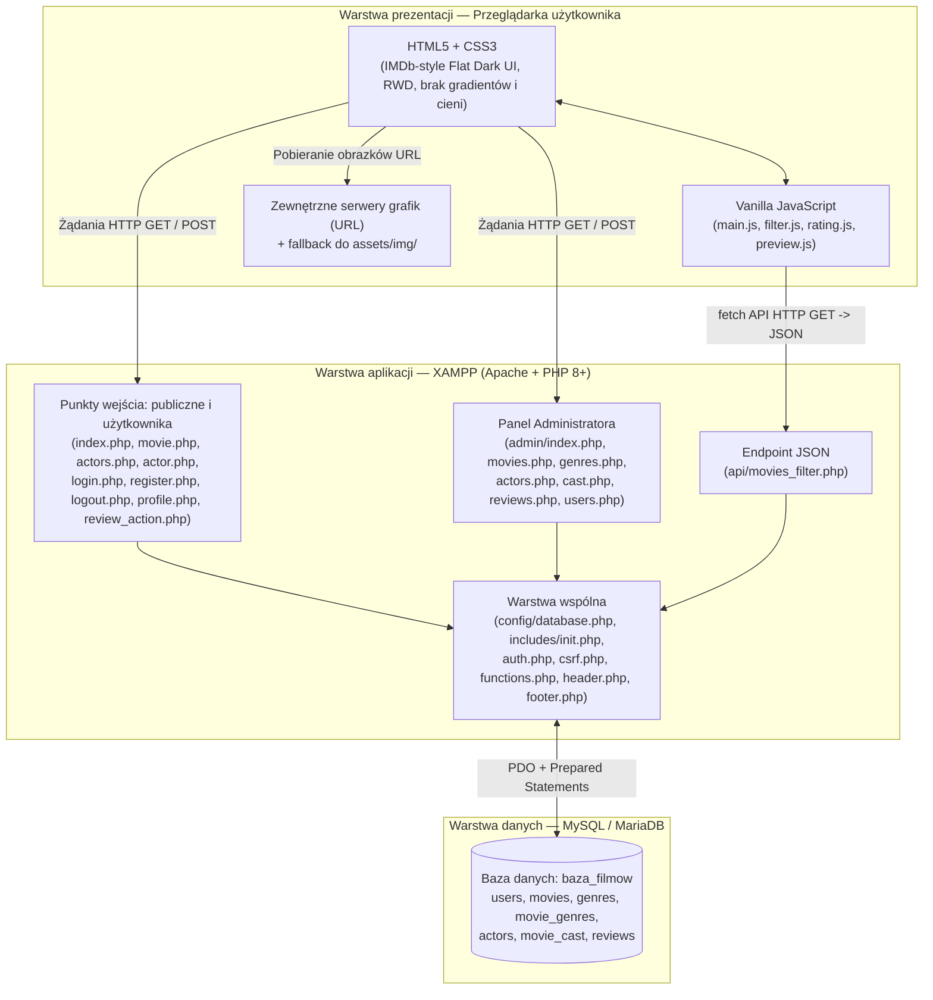
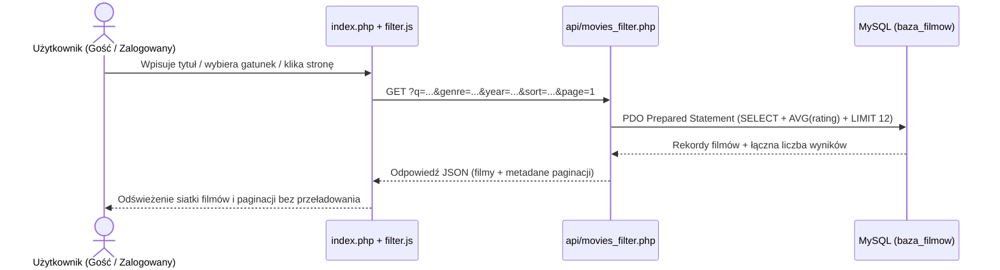
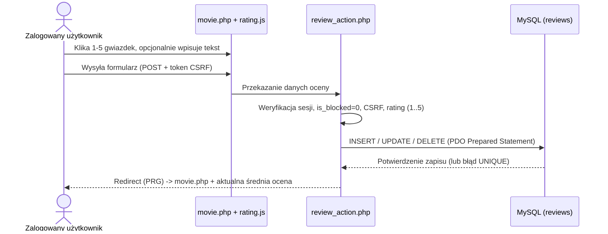

# Architektura aplikacji: „Baza filmów” (MovieDatabase)

> **Powiązany dokument:** `Docs/Specs.md`  
> **Środowisko uruchomieniowe:** XAMPP (`C:\xampp\htdocs\baza-filmow\`)  
> **Język aplikacji i dokumentacji:** polski  

---

## 1. Architektura ogólna aplikacji

Aplikacja **„Baza filmów” (MovieDatabase)** została zaprojektowana w klasycznej, trójwarstwowej architekturze **Client–Server–Database**, realizowanej w modelu **Server-Side Rendering (SSR) wzbogaconym o asynchroniczne żądania AJAX (`fetch` API)** dla dynamicznego filtrowania katalogu filmów.

Projekt świadomie rezygnuje z frameworków i złożonych wzorców na rzecz przejrzystej struktury proceduralno-modularnej w czystym PHP, aby kod był prosty, łatwy do debugowania i zrozumiały dla ucznia technikum.

### Główne założenia architektoniczne
1. **Wielostronicowa aplikacja PHP (MPA) + lekki endpoint JSON:**  
   Większość widoków jest renderowana bezpośrednio po stronie serwera przez PHP (`index.php`, `movie.php`, `actors.php`, `actor.php`, `profile.php`, `admin/*.php`), natomiast filtrowanie, wyszukiwanie, sortowanie i paginacja filmów mogą działać bez przeładowania strony dzięki `api/movies_filter.php`.
2. **Wspólna warstwa rdzenia (`includes/` i `config/`):**  
   Połączenie z bazą danych, autoryzacja sesyjna, ochrona CSRF, funkcje pomocnicze, walidacja URL oraz wspólny układ HTML (`header.php`, `footer.php`) są wydzielone do osobnych plików i dołączane w punktach wejścia aplikacji.
3. **Brak przechowywania przesyłanych plików graficznych na serwerze:**  
   Plakaty filmów (`poster_url`) i zdjęcia aktorów (`photo_url`) są przechowywane w bazie jako zewnętrzne adresy URL (`http://` / `https://`) z bezpiecznym mechanizmem zapasowym wskazującym na lokalne grafiki domyślne w `assets/img/`.
4. **Wyraźna separacja części publicznej i administracyjnej:**  
   Funkcje administracyjne znajdują się w odizolowanym katalogu `admin/`, chronionym po stronie serwera wspólną weryfikacją roli `admin` i statusu aktywności konta (`is_blocked = 0`).

### Diagram architektury systemu



---

## 2. Podział odpowiedzialności (Frontend, Backend, Baza danych)

| Warstwa | Zakres odpowiedzialności | Czego NIE robi (granice warstwy) |
| :--- | :--- | :--- |
| **Frontend**<br/>(`HTML5`, `CSS3`, `Vanilla JS`) | - Renderowanie struktury stron w przeglądarce.<br/>- Stylowanie w ciemnym motywie IMDb (flat UI, brak gradientów i zbędnych cieni, RWD).<br/>- Wstępna walidacja formularzy po stronie klienta (`main.js`).<br/>- Interaktywny wybór 1–5 gwiazdek (`rating.js`).<br/>- Podgląd na żywo obrazków z pola URL (`preview.js`).<br/>- Dynamiczne pobieranie i renderowanie przefiltrowanych filmów (`filter.js`).<br/>- Wyświetlanie okien potwierdzenia (`confirm`) przed akcjami usuwania i blokowania. | - Nie podejmuje ostatecznych decyzji o uprawnieniach ani bezpieczeństwie.<br/>- Nie komunikuje się bezpośrednio z bazą danych.<br/>- Nie zastępuje walidacji po stronie serwera. |
| **Backend**<br/>(`PHP 8+`, `PDO`, `Apache`) | - Obsługa sesji użytkowników, logowania, rejestracji i wylogowania.<br/>- Egzekwowanie kontroli dostępu (Gość / `user` / `admin` oraz blokada `is_blocked`).<br/>- Generowanie i weryfikacja tokenów CSRF dla wszystkich operacji `POST`.<br/>- Walidacja danych wejściowych, w tym sprawdzanie poprawności URL (`http://` / `https://`).<br/>- Escapowanie danych wyjściowych (`htmlspecialchars`) przeciwko XSS.<br/>- Wykonywanie zapytań SQL przez PDO Prepared Statements.<br/>- Przekazywanie gotowych widoków HTML lub odpowiedzi JSON (`api/movies_filter.php`). | - Nie przechowuje haseł w postaci jawnej.<br/>- Nie przyjmuje plików graficznych na dysk serwera (obsługuje wyłącznie linki URL).<br/>- Nie zawiera zbędnej logiki prezentacji w skryptach bazy danych. |
| **Baza danych**<br/>(`MySQL / MariaDB`) | - Trwałe przechowywanie danych aplikacji (`users`, `movies`, `genres`, `movie_genres`, `actors`, `movie_cast`, `reviews`).<br/>- Utrzymanie integralności referencyjnej przez klucze obce i `ON DELETE CASCADE`.<br/>- Wymuszanie unikalności (`username`, `email`, `genres.name`, `UNIQUE (movie_id, user_id)` w `reviews`).<br/>- Walidacja zakresu ocen (`CHECK (rating BETWEEN 1 AND 5)`).<br/>- Indeksowanie kolumn używanych do wyszukiwania, filtrowania i sortowania. | - Nie przechowuje logiki sesji PHP ani reguł renderowania HTML.<br/>- Nie przechowuje plików binarnych (jedynie ścieżki URL jako `VARCHAR(500)`). |

---

## 3. Technologie i sposób ich wykorzystania

### 3.1. Środowisko uruchomieniowe: XAMPP
- **Apache:** serwer HTTP obsługujący żądania z przeglądarki, wykonujący skrypty PHP oraz respektujący pliki `.htaccess` blokujące bezpośredni dostęp do katalogów `config/` i `includes/`.
- **MySQL / MariaDB:** relacyjny silnik bazy danych zarządzany np. przez phpMyAdmin w XAMPP, przechowujący schemat `sql/schema.sql` i dane testowe `sql/seed.sql`.

### 3.2. Backend: czysty PHP 8+
- **PDO (PHP Data Objects):** jedyny sposób komunikacji z bazą danych. Każde zapytanie wykorzystujące dane od użytkownika używa `prepare()` i `execute()` (ochrona przed SQL Injection).
- **Sesje PHP (`$_SESSION`):** przechowują identyfikator zalogowanego użytkownika, jego rolę (`user`/`admin`), token CSRF oraz komunikaty zwrotne (*flash messages*). Po udanym logowaniu wywoływane jest `session_regenerate_id(true)`.
- **Bezpieczeństwo haseł i danych:** `password_hash()` (domyślny algorytm bcrypt/argon2), `password_verify()`, `htmlspecialchars(..., ENT_QUOTES, 'UTF-8')` oraz `filter_var()` + `parse_url()` do weryfikacji adresów URL (`http` / `https`).

### 3.3. Baza danych: MySQL / MariaDB
- **Relacje 1:N i N:M:**
  - Film ↔ Gatunki: relacja **N:M** realizowana przez tabelę pośrednią `movie_genres`.
  - Film ↔ Aktorzy (Obsada): relacja **N:M** z dodatkowym atrybutem `character_name` w tabeli `movie_cast`.
  - Użytkownik ↔ Recenzje i Film ↔ Recenzje: relacje **1:N** z ograniczeniem `UNIQUE (movie_id, user_id)`.
- **Agregacje po stronie SQL:** średnia ocena filmu (`AVG(rating)`) oraz liczba recenzji (`COUNT(id)`) są obliczane bezpośrednio w zapytaniach SQL, co gwarantuje spójność wyników niezależnie od miejsca wyświetlenia.

### 3.4. Frontend: HTML5, CSS3, Vanilla JavaScript
- **HTML5:** semantyczne znaczniki (`header`, `nav`, `main`, `section`, `article`, `footer`) oraz natywne typy pól formularzy (`email`, `url`, `number`, `password`).
- **CSS3 (`assets/css/style.css`):**
  - Układy oparte na **CSS Grid** (siatka kart filmów i aktorów, 12 pozycji na stronę) oraz **Flexbox** (nawigacja, paski filtrów, układ szczegółów filmu).
  - Pełne **RWD** z wykorzystaniem `@media` queries dla smartfonów, tabletów i desktopu.
  - Stylistyka **IMDb Flat Dark UI**: ciemne powierzchnie (`#121212`, `#1a1a1a`, `#1f1f1f`), akcent `#f5c518`, cienkie obramowania (`1px solid #2c2c2c`), **całkowity brak gradientów oraz zbędnych cieni (`box-shadow` / `drop-shadow`)**.
- **Vanilla JavaScript (`assets/js/`):**
  - `filter.js`: obsługa zdarzeń filtrów/wyszukiwarki/sortowania/paginacji i komunikacja z `api/movies_filter.php` za pomocą `fetch()`.
  - `rating.js`: obsługa klikalnych gwiazdek `1–5` synchronizowana z ukrytym polem formularza.
  - `preview.js`: podgląd na żywo obrazka z wpisanego linku URL z obsługą zdarzenia `onerror` (powrót do domyślnego obrazka).
  - `main.js`: walidacja formularzy przed wysłaniem, dialogi `confirm()` przy usuwaniu/blokowaniu oraz obsługa menu mobilnego.

---

## 4. Komunikacja między komponentami

W aplikacji występują trzy główne kanały komunikacji:

### 4.1. Przeglądarka ↔ Strony PHP (klasyczny model HTTP GET/POST)
- **Żądania `GET`:** ładowanie stron katalogu (`index.php`, `actors.php`), podstron szczegółowych (`movie.php?id=...`, `actor.php?id=...`), profilu (`profile.php`) i widoków Panelu Administratora (`admin/*.php`).
- **Żądania `POST`:** wysyłanie formularzy modyfikujących stan aplikacji (rejestracja, logowanie, dodanie/edycja/usunięcie recenzji w `review_action.php`, operacje CRUD w `admin/*.php`).  
  Każde żądanie `POST` stosuje wzorzec **PRG (Post/Redirect/Get)**: po przetworzeniu danych i zapisie komunikatu *flash* w sesji serwer zwraca przekierowanie HTTP (`header('Location: ...')`), co zapobiega ponownemu wysłaniu formularza przy odświeżeniu strony.

### 4.2. Vanilla JS ↔ Backend API (`fetch` + JSON)
- Skrypt `assets/js/filter.js` przechwytuje zmiany w wyszukiwarce tytułu, filtrze gatunku, filtrze roku, sortowaniu oraz kliknięcia przycisków paginacji.
- Wysyła asynchroniczne żądanie `GET` pod adres `api/movies_filter.php?q=...&genre=...&year=...&sort=...&page=...`.
- Backend (`api/movies_filter.php`) wykonuje zapytanie przygotowane PDO do MySQL (z `LIMIT 12 OFFSET ...`) i zwraca odpowiedź `Content-Type: application/json` zawierającą listę filmów (z gotowymi wyliczonymi średnimi ocenami i gatunkami) oraz metadane paginacji (`total_pages`, `current_page`, `total_items`).
- JavaScript aktualizuje siatkę kart filmów i pasek paginacji w DOM bez przeładowania strony (z aktualizacją URL w przeglądarce przez `history.replaceState` lub obsługą standardowego fallbacku `GET`).

### 4.3. Backend PHP ↔ Warstwa wspólna ↔ MySQL
- Każdy publiczny lub administracyjny plik PHP rozpoczyna się od dołączenia `includes/init.php`, który:
  1. Uruchamia bezpieczną sesję,
  2. Ładuje połączenie PDO z `config/database.php`,
  3. Ładuje helpery `auth.php`, `csrf.php` i `functions.php`,
  4. W przypadku zalogowanego użytkownika weryfikuje w bazie (lub sesji) aktualny status `is_blocked`, wymuszając wylogowanie w razie zablokowania konta.

### 4.4. Przeglądarka ↔ Zewnętrzne zasoby obrazków (URL)
- Backend przekazuje do widoku zweryfikowany adres `poster_url` / `photo_url` (lub ścieżkę lokalną do domyślnej grafiki, jeśli URL jest pusty).
- Przeglądarka pobiera obraz bezpośrednio z zewnętrznego URL. W przypadku błędu ładowania (np. wygasły link zewnętrzny) atrybut lub handler JS podmienia `src` na `assets/img/default-poster.png` lub `assets/img/default-actor.png`.

---

## 5. Struktura katalogów i plików

Ścieżka bazowa w XAMPP: `C:\xampp\htdocs\baza-filmow\`

```text
baza-filmow/
├── Docs/
│   ├── Specs.md                     # Specyfikacja wymagań funkcjonalnych i niefunkcjonalnych
│   ├── Architecture.md              # Dokumentacja architektury aplikacji (ten plik)
│   └── Sessions/
│       └── Planning.md              # Zapis sesji planowania i decyzji
├── sql/
│   ├── schema.sql                   # Definicja tabel, kluczy obcych, ograniczeń i indeksów
│   └── seed.sql                     # Dane startowe (gatunki, 15+ filmów, aktorzy, obsada, recenzje, konta)
├── config/
│   ├── .htaccess                    # Blokada bezpośredniego dostępu HTTP (Deny from all)
│   └── database.php                 # Konfiguracja i instancja połączenia PDO z MySQL
├── includes/
│   ├── .htaccess                    # Blokada bezpośredniego dostępu HTTP (Deny from all)
│   ├── init.php                     # Inicjalizacja sesji, konfiguracji i ładowanie bibliotek pomocniczych
│   ├── auth.php                     # Logowanie, wylogowanie, kontrola ról i blokady is_blocked
│   ├── csrf.php                     # Generowanie, osadzanie i walidacja tokenów CSRF
│   ├── functions.php                # Escapowanie XSS, walidacja URL http/https, fallback grafik, paginacja, flash
│   ├── header.php                   # Wspólny nagłówek HTML, meta RWD, pasek nawigacji
│   └── footer.php                   # Wspólna stopka HTML oraz podpięcie skryptów JS
├── api/
│   └── movies_filter.php            # Endpoint JSON: wyszukiwanie, filtrowanie, sortowanie i paginacja (12/str.)
├── admin/
│   ├── index.php                    # Pulpit Panelu Administratora (statystyki bazy i skróty)
│   ├── movies.php                   # Zarządzanie filmami (CRUD, wybór wielu gatunków, pole URL plakatu)
│   ├── genres.php                   # Zarządzanie gatunkami filmowymi (CRUD)
│   ├── actors.php                   # Zarządzanie aktorami (CRUD, pole URL zdjęcia)
│   ├── cast.php                     # Zarządzanie obsadą filmów (przypisanie aktora i nazwy postaci)
│   ├── reviews.php                  # Przegląd i moderacja (usuwanie) recenzji
│   └── users.php                    # Zarządzanie użytkownikami (lista, blokowanie/odblokowywanie, usuwanie)
├── assets/
│   ├── css/
│   │   └── style.css                # IMDb-style Flat Dark UI (bez gradientów, bez zbędnych cieni, RWD)
│   ├── js/
│   │   ├── main.js                  # Walidacja formularzy, confirm() dla akcji krytycznych, menu mobilne
│   │   ├── filter.js                # Asynchroniczne filtrowanie i paginacja filmów przez fetch
│   │   ├── rating.js                # Interaktywny wybór oceny 1–5 gwiazdek
│   │   └── preview.js               # Podgląd na żywo obrazka na podstawie pola input[type="url"]
│   └── img/
│       ├── default-poster.png       # Domyślny plakat filmu (fallback)
│       └── default-actor.png        # Domyślne zdjęcie aktora (fallback)
├── index.php                        # Katalog filmów (widok główny, 12/str.)
├── movie.php                        # Szczegóły filmu, obsada, średnia gwiazdek i recenzje
├── actors.php                       # Katalog aktorów (12/str.) + wyszukiwarka
├── actor.php                        # Profil aktora i lista filmów wraz z rolami
├── login.php                        # Wspólny formularz logowania (user i admin)
├── register.php                     # Rejestracja nowego użytkownika
├── logout.php                       # Zakończenie sesji użytkownika
├── profile.php                      # Profil zalogowanego użytkownika z listą jego recenzji
└── review_action.php                # Obsługa żądań POST: dodanie, edycja i usunięcie recenzji
```

---

## 6. Przepływ danych podczas najważniejszych operacji użytkownika

### 6.1. Dynamiczne wyszukiwanie, filtrowanie i paginacja filmów
1. Użytkownik wpisuje fragment tytułu lub zmienia filtr gatunku/roku/sortowania w `index.php`.
2. `filter.js` przechwytuje zdarzenie, składa parametry zapytania i wysyła asynchroniczne żądanie `GET` do `api/movies_filter.php`.
3. `api/movies_filter.php` waliduje parametry (białe listy dla kolumn sortowania, rzutowanie `int` dla roku, gatunku i numeru strony) i wykonuje przygotowane zapytania `SELECT` (z `LEFT JOIN` na `reviews` oraz `movie_genres`, `LIMIT 12`).
4. Endpoint zwraca strukturę JSON z listą filmów (ze bezpiecznie przefiltrowanym `poster_url` lub ścieżką domyślną) oraz danymi paginacji.
5. `filter.js` bezpiecznie renderuje karty filmów (unikając wstrzyknięcia nieescapowanego HTML) i aktualizuje przyciski paginacji.



---

### 6.2. Rejestracja, logowanie i weryfikacja uprawnień
1. **Rejestracja (`register.php`):**  
   Użytkownik wypełnia formularz (login, e-mail, hasło, potwierdzenie hasła). `main.js` wykonuje wstępną walidację długości i zgodności haseł. Po wysłaniu `POST` backend weryfikuje token CSRF, sprawdza unikalność loginu i e-maila w `users`, haszuje hasło przez `password_hash()` i zapisuje nowy rekord z rolą `'user'` oraz `is_blocked = 0`.
2. **Logowanie (`login.php`):**  
   Wspólny formularz dla ról `user` i `admin`. Backend weryfikuje CSRF, pobiera użytkownika po loginie/e-mailu, sprawdza hasło przez `password_verify()`, a następnie kontroluje `is_blocked`.
   - Jeśli `is_blocked == 1`, logowanie zostaje odrzucone z komunikatem o blokadzie konta.
   - Jeśli konto jest aktywne, wywoływane jest `session_regenerate_id(true)`, dane trafiają do `$_SESSION`, a dla roli `admin` w nawigacji pojawia się odnośnik do `admin/index.php`.

---

### 6.3. Dodawanie, edycja i usuwanie oceny/recenzji (1–5 gwiazdek)
1. Zalogowany użytkownik otwiera `movie.php?id=X`. Backend sprawdza w bazie, czy użytkownik dodał już ocenę dla tego filmu.
   - Jeśli nie: wyświetla formularz dodania nowej oceny (wybór 1–5 gwiazdek obsługiwany przez `rating.js` + opcjonalne pole `comment`).
   - Jeśli tak: wyświetla formularz edycji istniejącej oceny/recenzji oraz przycisk usunięcia (chroniony przez `confirm` w `main.js`).
2. Wysłanie formularza kieruje żądanie `POST` (z tokenem CSRF) do `review_action.php`.
3. `review_action.php` weryfikuje po stronie serwera: zalogowanie użytkownika, status `is_blocked == 0`, token CSRF, poprawność zakresu `rating` (`1`–`5`) oraz — przy edycji/usuwaniu — czy użytkownik jest autorem danej recenzji.
4. Dane są zapisywane w `reviews` (klucz `UNIQUE (movie_id, user_id)` dodatkowo chroni przed duplikatami na poziomie bazy), po czym następuje przekierowanie PRG z powrotem na `movie.php?id=X` (lub `profile.php`), gdzie od razu widoczna jest przeliczona średnia ocena filmu.



---

### 6.4. Przeglądanie szczegółów filmu, obsady i profilu aktora
1. Na stronie `movie.php?id=X` backend pobiera:
   - dane filmu z `movies` oraz wyliczoną średnią `AVG(rating)` i `COUNT(id)` z `reviews`,
   - listę przypisanych gatunków przez `JOIN` z `movie_genres` i `genres`,
   - listę obsady przez `JOIN` z `movie_cast` i `actors` (imię, nazwisko, `photo_url`, `character_name`),
   - listę recenzji wraz z nazwami autorów (`users.username`), posortowaną od najnowszych.
2. Kliknięcie aktora przenosi użytkownika na `actor.php?id=Y`, gdzie backend pobiera dane biograficzne aktora oraz listę filmów z `movie_cast` i `movies` (tytuł, rok, `poster_url`, `character_name`).
3. Jeśli `poster_url` lub `photo_url` są puste albo obrazek nie załaduje się w przeglądarce, używane są lokalne zasoby `assets/img/default-poster.png` oraz `assets/img/default-actor.png`.

---

### 6.5. Zarządzanie zasobami w Panelu Administratora
1. Każde wejście do pliku w katalogu `admin/` uruchamia strażnika uprawnień w `includes/auth.php` (`requireAdmin()`), który odrzuca gości, zablokowane konta i użytkowników o roli `user`.
2. **Zarządzanie filmami i aktorami (`admin/movies.php`, `admin/actors.php`):**
   - Podczas wpisywania adresu URL plakatu lub zdjęcia skrypt `preview.js` na bieżąco wyświetla podgląd obrazka w formularzu.
   - Po wysłaniu `POST` backend weryfikuje CSRF, waliduje pola tekstowe/liczbowe oraz sprawdza adres URL funkcją w `includes/functions.php` (dozwolone wyłącznie `http://` i `https://` lub puste pole zapisywane jako `NULL`).
   - Przy zapisie filmu w `admin/movies.php` zapisywane są również powiązania N:M w `movie_genres` (w ramach transakcji PDO).
3. **Zarządzanie obsadą (`admin/cast.php`):**
   - Administrator wybiera film, aktora oraz wpisuje nazwę granej postaci (`character_name`), tworząc lub usuwając rekord w `movie_cast`.
4. **Moderacja recenzji (`admin/reviews.php`):**
   - Administrator widzi listę recenzji i po potwierdzeniu (`confirm` w `main.js`) może usunąć dowolny wpis w `reviews` (z weryfikacją CSRF).
5. **Zarządzanie użytkownikami (`admin/users.php`):**
   - Administrator przegląda listę kont z ich rolą i statusem blokady oraz może wykonać akcję **Zablokuj / Odblokuj** (`UPDATE users SET is_blocked = ...`) lub **Usuń konto** (`DELETE FROM users WHERE id = ...`, co kaskadowo usuwa też recenzje użytkownika przez `ON DELETE CASCADE`).
   - Warstwa backendu blokuje możliwość zablokowania lub usunięcia własnego konta aktualnie zalogowanego administratora.

---

## 7. Podsumowanie spójności ze `Specs.md`

- Wszystkie wymagania funkcjonalne (**FR-01 – FR-29**) oraz niefunkcjonalne (**NFR-01 – NFR-12**) ze `Specs.md` zostały bezpośrednio odwzorowane w komponentach i przepływach danych.
- Zachowano skalę ocen **1–5 gwiazdek** (z opcjonalnym tekstem i limitem 1 recenzji na film od użytkownika), zewnętrzne linki **URL** dla plakatów i zdjęć aktorów, **RWD**, **paginację 12/str.** oraz **ciemny flat UI w stylu IMDb** bez gradientów i zbędnych cieni.