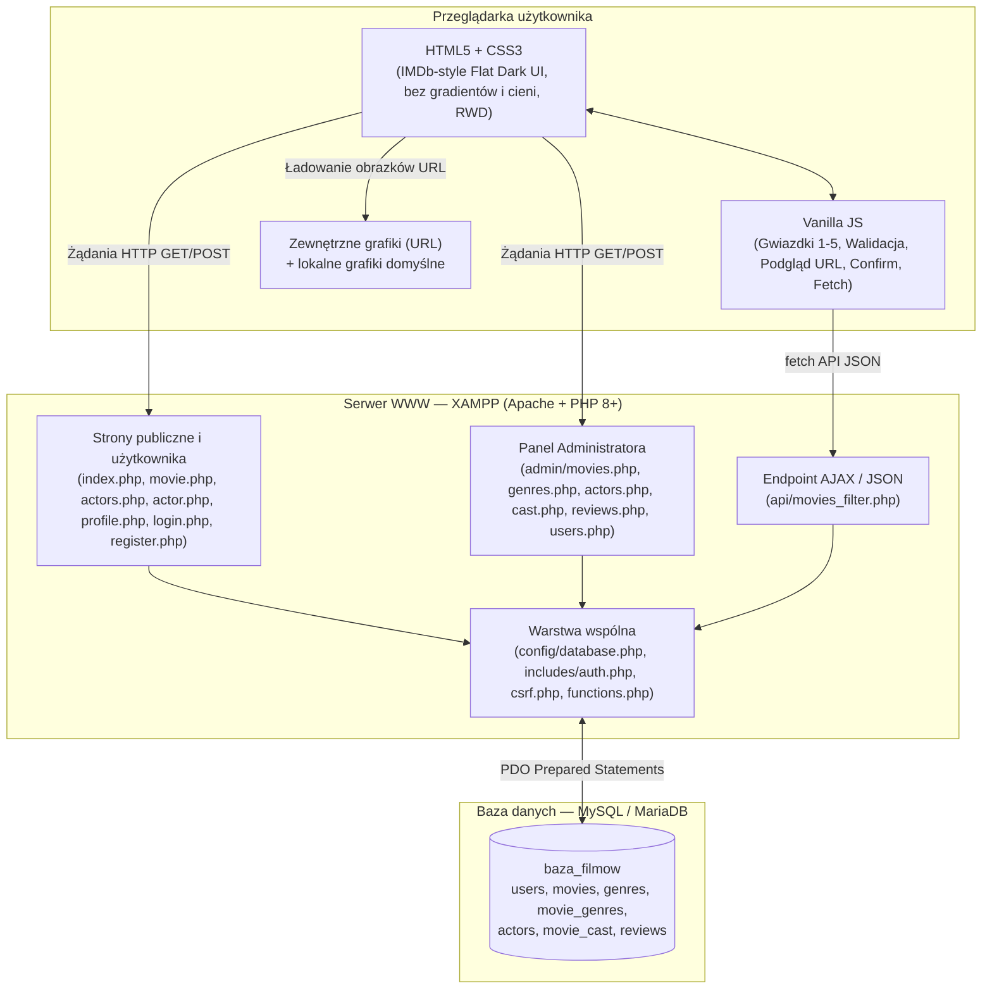
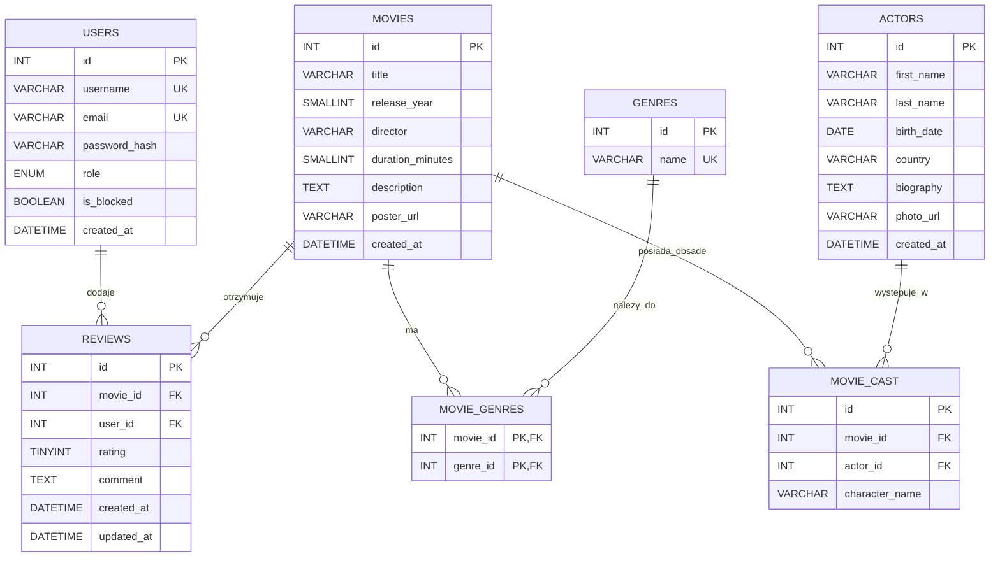
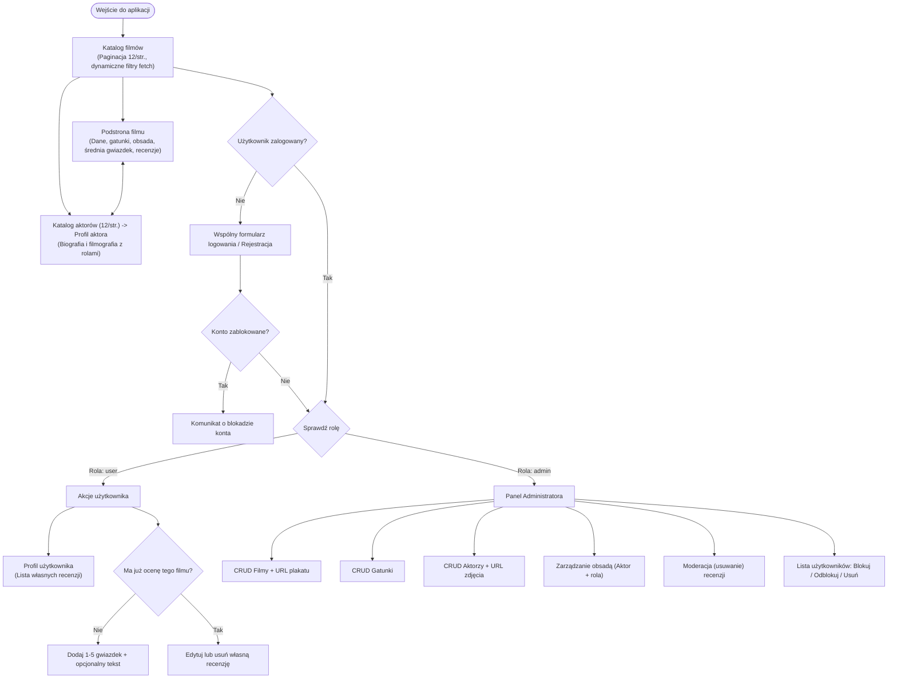

# Dokumentacja projektowa i specyfikacja: „Baza filmów”

> **Cel dokumentu:** Kompletna specyfikacja planistyczna do przekazania agentom realizacyjnym (Database, Backend Public, Admin Panel, Frontend/JS, Security/QA).  
> **Środowisko:** XAMPP (Apache + PHP 8+ + MySQL/MariaDB)  
> **Technologie:** czysty PHP (PDO), MySQL, HTML5, CSS3, Vanilla JavaScript (bez zewnętrznych frameworków)  
> **Zasada kodu:** Prosty, czytelny i zrozumiały kod dla ucznia technikum, interfejs w języku polskim.

---

## 1. Podsumowanie decyzji projektowych (z sesji planowania)

- **Role:** Gość, Zalogowany użytkownik (`user`), Administrator (`admin` w bazie, wspólny formularz logowania).
- **Filmy:** tytuł, rok produkcji, wiele gatunków (N:M), reżyser, czas trwania, opis, plakat podawany jako **adres URL** (z domyślną grafiką zastępczą w razie braku lub błędu ładowania), paginacja (12/str.), wyszukiwanie, filtrowanie i sortowanie.
- **Aktorzy i obsada:** imię, nazwisko, data urodzenia, kraj pochodzenia, biografia, zdjęcie jako **adres URL** (z domyślną grafiką zastępczą), osobna podstrona profilu aktora z filmografią, zapis nazwy granej postaci w obsadzie, paginacja aktorów (12/str.).
- **Recenzje i oceny:** skala **1–5 gwiazdek**, średnia ocena i liczba recenzji wyliczane automatycznie, tekst recenzji opcjonalny (można wystawić samą ocenę), maksymalnie **1 recenzja na film od jednego użytkownika**, autor może edytować i usuwać swoją recenzję, administrator może usuwać dowolne recenzje.
- **Konta i Panel Administratora:** profil użytkownika z listą własnych recenzji; administrator ma podgląd listy użytkowników z możliwością **blokowania/odblokowywania oraz usuwania kont**.
- **Design i UX:** styl **IMDb** — ciemny motyw, **RWD**, profesjonalny, funkcjonalny i **sleek** (flat UI: **bez gradientów** i **bez zbędnych cieni `box-shadow` / `drop-shadow`**).
- **JavaScript (Vanilla JS):** wybór 1–5 gwiazdek, walidacja formularzy, potwierdzenia przed akcjami usuwania/blokowania, podgląd obrazka z wpisanego linku URL przed zapisem, dynamiczne wyszukiwanie/filtrowanie/sortowanie/paginacja przez `fetch`.
- **Bezpieczeństwo:** PDO + Prepared Statements, `password_hash`/`password_verify`, `htmlspecialchars`, tokeny CSRF, walidacja adresów URL (`http://` / `https://`).

---

## 2. Role użytkowników i uprawnienia

| Rola | Uprawnienia |
| :--- | :--- |
| **Gość (niezalogowany)** | Przeglądanie katalogu filmów i aktorów, wyszukiwanie/filtrowanie/sortowanie filmów, podgląd szczegółów filmu, obsady, profili aktorów i recenzji, rejestracja, logowanie. |
| **Zalogowany użytkownik (`user`)** | Wszystko co Gość + dodawanie oceny (**1–5 gwiazdek**) i opcjonalnego tekstu recenzji (max 1 na film), edycja i usuwanie własnych recenzji, podgląd swojego profilu z listą własnych recenzji, wylogowanie. |
| **Administrator (`admin`)** | Wszystko co Zalogowany użytkownik + dostęp do Panelu Administratora (link widoczny po zalogowaniu): CRUD filmów (plakat jako URL), CRUD gatunków, CRUD aktorów (zdjęcie jako URL), zarządzanie obsadą filmów (aktor + nazwa postaci), usuwanie dowolnych recenzji, podgląd listy użytkowników oraz blokowanie/odblokowywanie i usuwanie kont. |

---

## 3. Wymagania funkcjonalne (FR)

### 3.1. Katalog filmów i szczegóły filmu
- **FR-01:** Katalog filmów wyświetla pozycje z **paginacją po 12 filmów na stronę**.
- **FR-02:** Każdy film zawiera: tytuł, rok produkcji, **wiele gatunków** (relacja N:M), reżysera, czas trwania (w minutach), opis fabuły, plakat (zewnętrzny **adres URL** lub lokalny obrazek zastępczy `default-poster.png`) oraz wyliczaną automatycznie średnią ocenę i liczbę recenzji.
- **FR-03:** Dynamiczne wyszukiwanie, filtrowanie i sortowanie filmów przez `fetch` + JSON: po tytule, gatunku, roku produkcji oraz sortowanie (najwyżej oceniane, najnowsze, alfabetycznie).
- **FR-04:** Podstrona filmu prezentuje pełne dane, gatunki, średnią ocenę w gwiazdkach, obsadę (aktor + rola z linkiem do profilu aktora) oraz listę recenzji.

### 3.2. Aktorzy i obsada
- **FR-05:** Katalog aktorów z **paginacją po 12 pozycji na stronę** oraz wyszukiwarką po imieniu/nazwisku.
- **FR-06:** Aktor zawiera: imię, nazwisko, datę urodzenia, kraj pochodzenia, krótką biografię oraz zdjęcie (zewnętrzny **adres URL** lub lokalny obrazek zastępczy `default-actor.png`).
- **FR-07:** Osobna podstrona profilu aktora prezentuje jego dane oraz listę filmów, w których zagrał, wraz z nazwą granej postaci.
- **FR-08:** Obsada zapisuje powiązanie Film ↔ Aktor oraz **nazwę granej postaci**.

### 3.3. Recenzje i oceny
- **FR-09:** Zalogowany, niezablokowany użytkownik może dodać ocenę **1–5 gwiazdek** (wymagana) oraz opcjonalną treść recenzji (można dodać ocenę bez tekstu).
- **FR-10:** Jeden użytkownik może dodać **maksymalnie jedną ocenę/recenzję do danego filmu**.
- **FR-11:** Autor może **edytować i usuwać** swoją recenzję.
- **FR-12:** Średnia ocena filmu i liczba recenzji aktualizują się automatycznie.
- **FR-13:** Administrator może usunąć dowolną recenzję (moderacja).

### 3.4. Konta użytkowników i autoryzacja
- **FR-14:** Rejestracja wymaga: nazwy użytkownika (login), adresu e-mail, hasła oraz potwierdzenia hasła.
- **FR-15:** Logowanie użytkowników i administratorów przez jeden wspólny formularz.
- **FR-16:** Zablokowane konto (`is_blocked = 1`) nie może się zalogować ani wykonywać chronionych akcji.
- **FR-17:** Zalogowany użytkownik ma podstronę profilu z podsumowaniem konta i listą własnych recenzji.

### 3.5. Panel Administratora
- **FR-18:** Dostęp wyłącznie dla zalogowanych kont z rolą `admin`.
- **FR-19:** CRUD filmów + przypisywanie wielu gatunków + podanie adresu URL plakatu.
- **FR-20:** CRUD gatunków filmowych.
- **FR-21:** CRUD aktorów + podanie adresu URL zdjęcia.
- **FR-22:** Zarządzanie obsadą filmów (dodawanie i usuwanie powiązań Film–Aktor z nazwą postaci).
- **FR-23:** Podgląd i usuwanie dowolnych recenzji.
- **FR-24:** Podgląd listy użytkowników + **blokowanie/odblokowywanie i usuwanie kont** (z blokadą uniemożliwiającą usunięcie lub zablokowanie własnego konta admina).

### 3.6. Interaktywność JavaScript (Vanilla JS)
- **FR-25:** Klikalny wybór **1–5 gwiazdek** przy dodawaniu i edycji recenzji.
- **FR-26:** Walidacja formularzy po stronie klienta (wymagane pola, format e-mail, format URL `http/https`, długość i zgodność haseł).
- **FR-27:** Okienka potwierdzenia (`confirm`) przed usuwaniem (filmu, aktora, gatunku, obsady, recenzji, użytkownika) i blokowaniem konta.
- **FR-28:** Podgląd na żywo plakatu lub zdjęcia aktora z wpisanego linku URL przed wysłaniem formularza w Panelu Admina (z automatycznym powrotem do domyślnego obrazka, jeśli link jest pusty lub niepoprawny).
- **FR-29:** Dynamiczne wyszukiwanie, filtrowanie, sortowanie i paginacja katalogu filmów przez `fetch` API bez przeładowania strony.

---

## 4. Wymagania niefunkcjonalne (NFR) i wytyczne Design / UI

### 4.1. Design i UX (IMDb-style Sleek Flat Dark UI)
- **NFR-01 (RWD):** Pełna responsywność (desktop, tablet, smartfon).
- **NFR-02 (Motyw kolorystyczny w stylu IMDb):** Ciemne, neutralne tła o wysokim kontraście (np. `#121212` tło strony, `#1a1a1a` / `#1f1f1f` karty i panele), czytelny biały/jasnoszary tekst (`#ffffff`, `#a3a3a3`), akcent żółto-złoty w stylu IMDb (`#f5c518`) dla gwiazdek ocen i głównych akcji.
- **NFR-03 (Flat & Sleek — bez gradientów i zbędnych cieni):**
  - **Brak jakichkolwiek gradientów** (`linear-gradient`, `radial-gradient`).
  - **Brak zbędnych cieni (`box-shadow`, `drop-shadow`)** — strukturę budują cienkie ramki (`1px solid #2c2c2c`), odstępy, siatka i typografia.
  - Maksymalna funkcjonalność, przejrzystość i profesjonalny wygląd bez zbędnych ozdobników.

### 4.2. Bezpieczeństwo
- **NFR-04:** Wyłącznie **PDO + Prepared Statements** (ochrona przed SQL Injection).
- **NFR-05:** Hasła haszowane przez `password_hash()` i weryfikowane przez `password_verify()`.
- **NFR-06:** Ochrona przed XSS przez `htmlspecialchars(..., ENT_QUOTES, 'UTF-8')`.
- **NFR-07:** Tokeny **CSRF** we wszystkich formularzach `POST`.
- **NFR-08:** Walidacja adresów URL obrazków po stronie serwera (`filter_var(..., FILTER_VALIDATE_URL)` oraz wymuszenie schematu wyłącznie `http` lub `https` — blokada `javascript:`, `data:`, `file:`).
- **NFR-09:** Weryfikacja sesji, roli i statusu `is_blocked` po stronie serwera przy każdym chronionym żądaniu (`session_regenerate_id(true)` po zalogowaniu).

### 4.3. Jakość kodu i uruchamianie
- **NFR-10:** Brak zewnętrznych frameworków i bibliotek.
- **NFR-11:** Czytelny podział plików i zrozumiałe komentarze w kodzie.
- **NFR-12:** Uruchamianie w `htdocs/baza-filmow` pod XAMPP bez dodatkowej konfiguracji serwera.

---

## 5. Diagram architektury (Mermaid)



---

## 6. Diagram ERD bazy danych (Mermaid)



**Kluczowe więzy integralności w bazie:**
- `MOVIES.poster_url` oraz `ACTORS.photo_url`: `VARCHAR(500) NULL` (opcjonalne; gdy `NULL` lub pusty ciąg, aplikacja wyświetla lokalny obrazek domyślny).
- `REVIEWS.rating`: zakres `1–5` (`CHECK (rating BETWEEN 1 AND 5)`).
- `REVIEWS.comment`: `NULL` dozwolone (ocena bez tekstu).
- `REVIEWS`: `UNIQUE (movie_id, user_id)` (1 recenzja na film od użytkownika).
- `USERS.role`: `ENUM('user', 'admin')` domyślnie `'user'`.
- `ON DELETE CASCADE` na kluczach obcych w `MOVIE_GENRES`, `MOVIE_CAST` i `REVIEWS`.

---

## 7. Diagram workflow aplikacji (Mermaid)



---

## 8. Struktura katalogów projektu (XAMPP)

Ścieżka docelowa: `C:\xampp\htdocs\baza-filmow\`

```text
baza-filmow/
├── Docs/
│   ├── Specs.md                     # Ten plik (pełna dokumentacja i zadania)
│   └── Sessions/
│       └── Planning.md              # Zapis rozmowy planistycznej
├── sql/
│   ├── schema.sql                   # Tworzenie tabel i relacji bazy danych
│   └── seed.sql                     # Dane startowe (gatunki, 15+ filmów, aktorzy, obsada, recenzje, konto admina)
├── config/
│   ├── .htaccess                    # Deny from all
│   └── database.php                 # Połączenie PDO z MySQL
├── includes/
│   ├── .htaccess                    # Deny from all
│   ├── init.php                     # Sesja, stałe, ładowanie modułów pomocniczych
│   ├── auth.php                     # Logowanie, role, weryfikacja is_blocked
│   ├── csrf.php                     # Generowanie i sprawdzanie tokenów CSRF
│   ├── functions.php                # Escapowanie XSS, walidacja URL http/https, paginacja, flash messages, gwiazdki
│   ├── header.php                   # Wspólny nagłówek HTML i nawigacja
│   └── footer.php                   # Wspólna stopka i podłączenie JS
├── api/
│   └── movies_filter.php            # Endpoint JSON do dynamicznego wyszukiwania, filtrowania i paginacji
├── admin/
│   ├── index.php                    # Pulpit Administratora (statystyki i skróty)
│   ├── movies.php                   # CRUD filmów + gatunki + URL plakatu
│   ├── genres.php                   # CRUD gatunków
│   ├── actors.php                   # CRUD aktorów + URL zdjęcia
│   ├── cast.php                     # Zarządzanie obsadą filmu (aktor + nazwa roli)
│   ├── reviews.php                  # Lista i usuwanie recenzji
│   └── users.php                    # Lista użytkowników + blokowanie, odblokowywanie i usuwanie
├── assets/
│   ├── css/
│   │   └── style.css                # IMDb-style Flat Dark UI (zero gradientów, zero zbędnych cieni, RWD)
│   ├── js/
│   │   ├── main.js                  # Walidacja formularzy, confirm, menu mobilne
│   │   ├── filter.js                # Dynamiczne filtrowanie/wyszukiwanie/sortowanie/paginacja (fetch)
│   │   ├── rating.js                # Interaktywny wybór 1–5 gwiazdek
│   │   └── preview.js               # Podgląd na żywo obrazka z wpisanego pola URL
│   └── img/
│       ├── default-poster.png       # Domyślny plakat filmu (gdy brak URL lub błąd ładowania)
│       └── default-actor.png        # Domyślne zdjęcie aktora (gdy brak URL lub błąd ładowania)
├── index.php                        # Strona główna — katalog filmów (12/str.)
├── movie.php                        # Szczegóły filmu, obsada, średnia gwiazdek, recenzje
├── actors.php                       # Katalog aktorów (12/str.)
├── actor.php                        # Profil aktora i filmografia z rolami
├── login.php                        # Wspólne logowanie
├── register.php                     # Rejestracja użytkownika
├── logout.php                       # Wylogowanie
├── profile.php                      # Profil użytkownika i jego recenzje
└── review_action.php                # Obsługa dodawania/edycji/usuwania recenzji (POST)
```

---

## 9. Lista zadań dla pozostałych agentów

### Agent 1: Database Agent (MySQL)
1. Utworzyć `sql/schema.sql` z tabelami `users`, `movies` (`poster_url VARCHAR(500) NULL`), `genres`, `movie_genres`, `actors` (`photo_url VARCHAR(500) NULL`), `movie_cast`, `reviews` zgodnie z diagramem ERD.
2. Dodać ograniczenia: `UNIQUE (movie_id, user_id)` oraz `CHECK (rating BETWEEN 1 AND 5)` w `reviews`, `ON DELETE CASCADE` dla tabel zależnych oraz indeksy wspierające wyszukiwanie (`title`, `release_year`, `last_name`).
3. Utworzyć `sql/seed.sql` z przykładowymi gatunkami, min. 15 filmami (do przetestowania paginacji 12/str.), kilkunastoma aktorami, obsadą, recenzjami w skali 1–5 oraz startowymi kontami `admin` i `user` (hasła zahaszowane kompatybilnie z `password_verify()`).

### Agent 2: Backend Core & Public Agent (PHP)
1. Zaimplementować `config/database.php` (PDO) oraz warstwę `includes/` (`init.php`, `auth.php`, `csrf.php`, `functions.php` — w tym funkcję walidacji URL `http://`/`https://` oraz pomocnik zwracający URL obrazka lub domyślną ścieżkę `assets/img/default-*.png`).
2. Zaimplementować rejestrację (`register.php`), wspólne logowanie ze sprawdzaniem `is_blocked` (`login.php`), wylogowanie (`logout.php`) oraz profil użytkownika z listą jego recenzji (`profile.php`).
3. Zaimplementować strony publiczne: `index.php` (katalog filmów + paginacja 12/str.), `movie.php` (szczegóły, gatunki, obsada, średnia 1–5 gwiazdek, recenzje), `actors.php` (katalog aktorów + paginacja 12/str.), `actor.php` (profil aktora i filmografia z rolami).
4. Zaimplementować `api/movies_filter.php` zwracający przefiltrowane, posortowane i spaginowane filmy w JSON.
5. Zaimplementować `review_action.php` (dodanie oceny 1–5 z opcjonalnym tekstem, edycja, usunięcie własnej recenzji, kontrola limitu 1 recenzji na film).

### Agent 3: Admin Panel Agent (PHP)
1. Zabezpieczyć katalog `admin/` weryfikacją roli `admin` i aktywnego statusu konta po stronie serwera.
2. Zaimplementować `admin/index.php` (statystyki liczbowe i nawigacja panelu).
3. Zaimplementować `admin/movies.php` (CRUD filmów, wiele gatunków, pole URL plakatu z walidacją `http/https`) oraz `admin/genres.php` (CRUD gatunków).
4. Zaimplementować `admin/actors.php` (CRUD aktorów + pole URL zdjęcia z walidacją `http/https`) oraz `admin/cast.php` (przypisanie aktora i nazwy postaci do filmu).
5. Zaimplementować `admin/reviews.php` (lista i usuwanie recenzji) oraz `admin/users.php` (lista użytkowników + blokowanie/odblokowywanie i usuwanie kont z ochroną przed samoblokadą/samousunięciem).

### Agent 4: Frontend / UI & Vanilla JS Agent (HTML, CSS, JS)
1. Zaimplementować `includes/header.php`, `includes/footer.php` oraz `assets/css/style.css` w stylu **IMDb (ciemny motyw, sleek flat UI, RWD)**:
   - **Zero gradientów** (`linear-gradient` / `radial-gradient`).
   - **Zero zbędnych cieni** (`box-shadow` / `drop-shadow`).
   - Wyraźna siatka kart, cienkie ramki (`1px solid #2c2c2c`), złoto-żółty akcent gwiazdek (`#f5c518`), czytelne tabele w panelu admina, pełne RWD.
2. Przygotować grafiki zastępcze `default-poster.png` oraz `default-actor.png` (oraz obsługę błędu ładowania zewnętrznego obrazka z powrotem do domyślnego).
3. Zaimplementować skrypty w `assets/js/`:
   - `rating.js`: interaktywny wybór **1–5 gwiazdek**,
   - `filter.js`: dynamiczne filtrowanie, wyszukiwanie, sortowanie i paginacja przez `fetch`,
   - `preview.js`: podgląd na żywo obrazka z wpisanego pola `input[type="url"]` w formularzach filmów i aktorów,
   - `main.js`: walidacja formularzy po stronie klienta, potwierdzenia przed usuwaniem/blokowaniem, menu mobilne.

### Agent 5: Security & QA / Testing Agent
1. Zweryfikować brak konkatenacji zmiennych w SQL (wszędzie PDO Prepared Statements).
2. Sprawdzić escapowanie danych (`htmlspecialchars`), tokeny CSRF we wszystkich formularzach `POST` oraz haszowanie haseł.
3. Przetestować walidację adresów URL (odrzucanie protokołów takich jak `javascript:`, `data:`, `file:` oraz błędnych formatów).
4. Przetestować scenariusze dla ról: Gość, Zalogowany użytkownik (w tym limit 1 oceny na film i ocena bez tekstu), Zablokowany użytkownik, Administrator (w tym blokowanie i usuwanie kont).
5. Zweryfikować zgodność wizualną (brak gradientów i drop-shadow, RWD, działanie fallbacku obrazków) oraz działanie całości w XAMPP.