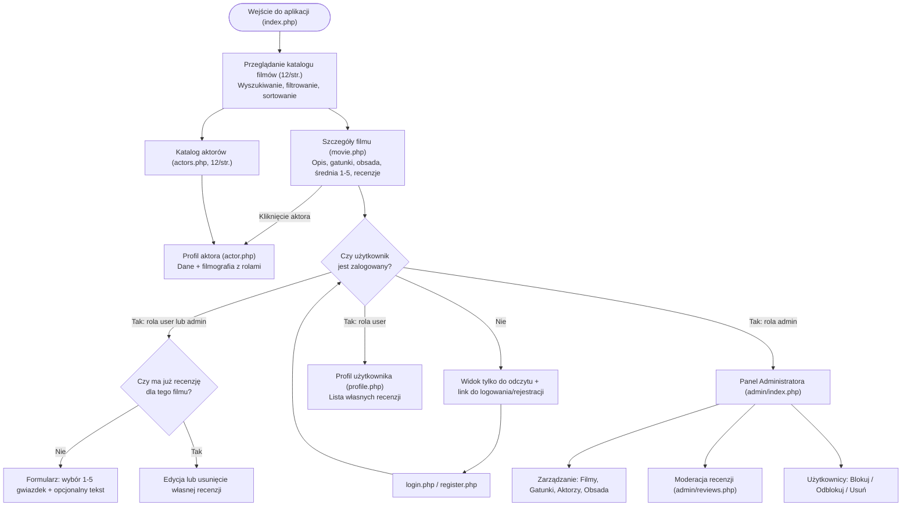
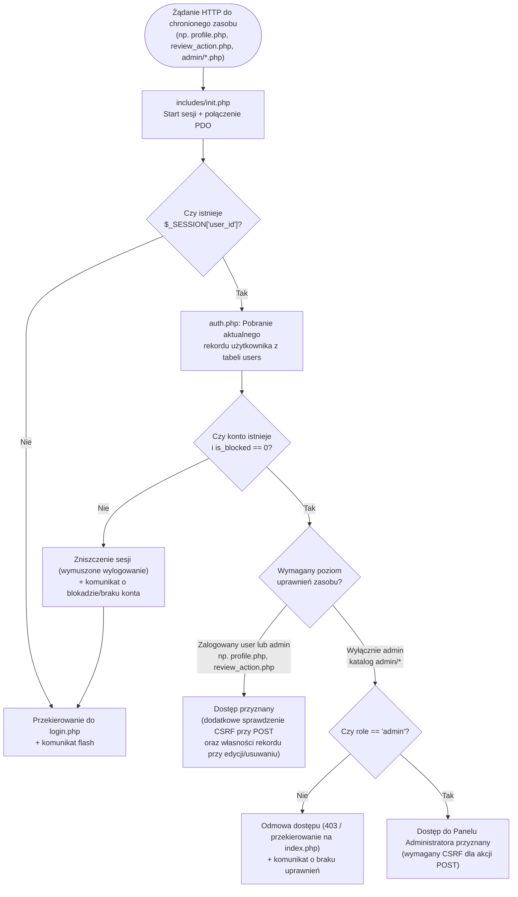

# Przepływ pracy i procesów (Workflow): „Baza filmów” (MovieDatabase)

> **Powiązane dokumenty:** `Docs/Specs.md`, `Docs/Architecture.md`  
> **Środowisko:** XAMPP (`C:\xampp\htdocs\baza-filmow\`)  
> **Język interfejsu:** polski

---

## 1. Workflow użytkownika (ścieżki korzystania z aplikacji)

Aplikacja obsługuje trzy role użytkowników: **Gość**, **Zalogowany użytkownik (`user`)** oraz **Administrator (`admin`)**. Ścieżka korzystania z systemu zależy od statusu zalogowania oraz przypisanej roli.

### 1.1. Ścieżka Gościa (użytkownik niezalogowany)
1. Użytkownik wchodzi na stronę główną (`index.php`), gdzie widzi responsywny katalog filmów w ciemnym motywie w stylu IMDb (po 12 filmów na stronę).
2. Może przeglądać kolejne strony paginacji, wpisać tytuł w wyszukiwarkę, filtrować po gatunku lub roku produkcji oraz zmienić sortowanie (najwyżej oceniane, najnowsze, alfabetycznie).
3. Kliknięcie wybranego filmu przenosi na `movie.php?id=...`, gdzie widoczne są: plakat (lub grafika zastępcza), szczegóły filmu, gatunki, średnia ocena (1–5 gwiazdek), liczba recenzji, pełna obsada z rolami oraz lista recenzji innych użytkowników.
4. Kliknięcie aktora na liście obsady (lub przejście do katalogu `actors.php`) prowadzi do `actor.php?id=...`, gdzie wyświetlana jest biografia aktora oraz lista filmów, w których wystąpił wraz z nazwą odgrywanej postaci.
5. Jeśli Gość chce dodać ocenę lub recenzję, musi przejść do rejestracji (`register.php`) lub logowania (`login.php`).

### 1.2. Ścieżka Zalogowanego użytkownika (`user`)
1. Po zalogowaniu przez wspólny formularz (`login.php`) w pasku nawigacji pojawiają się odnośniki do profilu (`profile.php`) i wylogowania (`logout.php`).
2. Na podstronie filmu (`movie.php`) zamiast komunikatu o konieczności logowania widoczny jest moduł oceniania:
   - jeśli użytkownik nie oceniał jeszcze tego filmu — może wybrać **1–5 gwiazdek** (wymagane) oraz opcjonalnie wpisać tekst recenzji;
   - jeśli już ocenił ten film — widzi swoją dotychczasową ocenę/recenzję z możliwością jej **edycji** lub **usunięcia**.
3. Na podstronie `profile.php` użytkownik widzi podsumowanie swojego konta oraz listę wszystkich wystawionych przez siebie recenzji wraz z szybkimi linkami do odpowiednich filmów, edycji lub usunięcia wpisu.

### 1.3. Ścieżka Administratora (`admin`)
1. Administrator loguje się przez ten sam formularz `login.php`. Po rozpoznaniu roli `admin` w nawigacji pojawia się dodatkowy link do **Panelu Administratora (`admin/index.php`)**.
2. Administrator zachowuje wszystkie możliwości zwykłego użytkownika (przeglądanie, ocenianie), a dodatkowo z pulpitu `admin/index.php` (zawierającego statystyki liczbowe bazy) przechodzi do modułów zarządzania:
   - **Filmy (`admin/movies.php`)** – dodawanie, edycja, usuwanie, przypisywanie wielu gatunków, podgląd i zapis URL plakatu;
   - **Gatunki (`admin/genres.php`)** – dodawanie, edycja, usuwanie gatunków;
   - **Aktorzy (`admin/actors.php`)** – dodawanie, edycja, usuwanie, podgląd i zapis URL zdjęcia;
   - **Obsada (`admin/cast.php`)** – przypisywanie aktorów i nazw granych postaci do filmów oraz usuwanie powiązań;
   - **Recenzje (`admin/reviews.php`)** – podgląd wszystkich recenzji i usuwanie wpisów naruszających zasady;
   - **Użytkownicy (`admin/users.php`)** – podgląd listy kont, blokowanie/odblokowywanie oraz usuwanie wybranych użytkowników.

### Diagram ogólnego workflow aplikacji

---

## 2. Przepływ danych (Frontend ↔ Backend PHP ↔ MySQL/MariaDB)

W aplikacji współistnieją dwa główne modele przepływu danych między warstwami:

### 2.1. Przepływ klasyczny SSR + PRG (strony HTML i formularze `POST`)
Stosowany na wszystkich podstronach (`movie.php`, `actors.php`, `actor.php`, `profile.php`, `login.php`, `register.php`, `review_action.php`, `admin/*.php`):

1. **Żądanie `GET`:**
   - Przeglądarka wysyła żądanie HTTP `GET` do odpowiedniego skryptu PHP.
   - Skrypt dołącza `includes/init.php`, który uruchamia sesję, nawiązuje połączenie PDO (`config/database.php`) i weryfikuje ewentualny stan zalogowania oraz blokady (`includes/auth.php`).
   - Backend pobiera dane z MySQL/MariaDB za pomocą **PDO Prepared Statements**, escapuje zmienne wyjściowe przez `htmlspecialchars()`, dołącza `includes/header.php` oraz `includes/footer.php` i zwraca gotowy dokument HTML.
2. **Żądanie `POST` (wzorzec Post/Redirect/Get):**
   - Użytkownik wysyła formularz; `main.js` wykonuje wstępną walidację po stronie klienta (oraz `confirm()` przy akcjach usuwania/blokowania).
   - Backend odbiera `POST`, weryfikuje token CSRF (`includes/csrf.php`), sprawdza uprawnienia i poprawność wszystkich danych wejściowych.
   - Wykonuje operację `INSERT`, `UPDATE` lub `DELETE` w bazie danych (w razie operacji wieloetapowych, np. zapis filmu i gatunków, w ramach transakcji PDO).
   - Zapisuje komunikat zwrotny (*flash message*) w `$_SESSION` i zwraca przekierowanie HTTP `302` (`header('Location: ...')`), aby odświeżenie strony nie powieliło akcji.

### 2.2. Przepływ asynchroniczny AJAX (`fetch` + JSON)
Stosowany w katalogu filmów na `index.php`:
1. `assets/js/filter.js` wykrywa zmianę w polu wyszukiwania, filtrach gatunku/roku, sortowaniu lub kliknięcie numeru strony paginacji.
2. Wysyła żądanie `GET` pod `api/movies_filter.php` z parametrami w URL.
3. Endpoint wykonuje bezpieczne zapytanie PDO do MySQL (z dynamicznie budowanymi warunkami na bazie przygotowanych parametrów i białych list sortowania) i zwraca wyłącznie dane w formacie **JSON**.
4. `filter.js` parsuje JSON i aktualizuje wyłącznie kontener kart filmów oraz pasek paginacji w drzewie DOM — bez przeładowania całej strony.

### 2.3. Przepływ zasobów graficznych (URL + Fallback)
1. Plakaty filmów (`movies.poster_url`) i zdjęcia aktorów (`actors.photo_url`) są zapisywane w bazie jako zewnętrzne adresy `http://` lub `https://` (lub `NULL`).
2. Backend zwraca w widoku (lub w JSON) zweryfikowany URL albo domyślną ścieżkę lokalną (`assets/img/default-poster.png`, `assets/img/default-actor.png`).
3. Przeglądarka ładuje obraz bezpośrednio z zewnętrznego URL. Jeśli link zewnętrzny okaże się niedostępny lub zwróci błąd HTTP, zdarzenie `onerror` w HTML/JS podmienia źródło `src` na lokalny obrazek domyślny.

---

## 3. Najważniejsze operacje — szczegółowy przebieg

### 3.1. Wyszukiwanie, filtrowanie, sortowanie i paginacja filmów
1. **Inicjalne wejście (`index.php`):** Backend pobiera listę dostępnych gatunków i lat produkcji do formularza filtrów oraz pierwszą stronę filmów (limit 12 rekordów, wraz z obliczonym `AVG(reviews.rating)` i liczbą recenzji).
2. **Interakcja użytkownika:** Użytkownik wpisuje frazę w pole tytułu, wybiera gatunek, rok lub sposób sortowania (np. *najwyżej oceniane*) albo zmienia stronę paginacji.
3. **Wywołanie `filter.js`:** Skrypt zbiera bieżące wartości filtrów, resetuje numer strony do `1` (przy zmianie kryteriów filtrowania) i wywołuje `fetch('api/movies_filter.php?...')`.
4. **Przetwarzanie w `api/movies_filter.php`:**
   - Rzutowanie i walidacja parametrów (`page >= 1`, `genre_id` i `year` jako liczby całkowite, `sort` dopasowane do ścisłej białej listy dozwolonych kolumn/kierunków).
   - Zapytanie `COUNT(DISTINCT movies.id)` wylicza całkowitą liczbę pasujących filmów i liczbę stron (`ceil(total / 12)`).
   - Główne zapytanie `SELECT` pobiera maksymalnie 12 filmów (`LIMIT 12 OFFSET (page - 1) * 12`) wraz z przypisanymi gatunkami i średnią oceną.
5. **Aktualizacja UI:** `filter.js` tworzy elementy kart filmów w stylu IMDb i aktualizuje przyciski paginacji (w razie 0 wyników wyświetla czytelny komunikat o braku dopasowań).

### 3.2. Przeglądanie szczegółów filmu, obsady i profilu aktora
1. **Szczegóły filmu (`movie.php?id=X`):**
   - Backend pobiera rekord filmu z `movies` oraz zagregowane `AVG(rating)` i `COUNT(id)` z `reviews`.
   - Pobiera gatunki filmu (`movie_genres` + `genres`).
   - Pobiera obsadę (`movie_cast` + `actors`) zawierającą `actor_id`, imię, nazwisko, `photo_url` i `character_name`.
   - Pobiera recenzje (`reviews` + `users.username`) posortowane od najnowszych.
   - Jeśli użytkownik jest zalogowany, sprawdza, czy w `reviews` istnieje już jego wpis dla `movie_id = X`.
2. **Katalog i profil aktora (`actors.php`, `actor.php?id=Y`):**
   - `actors.php` wyświetla listę aktorów z wyszukiwarką po imieniu/nazwisku i paginacją (12 aktorów na stronę).
   - `actor.php?id=Y` pobiera dane aktora z `actors` oraz całą jego filmografię z `movie_cast` połączoną z `movies` (tytuł, rok, `poster_url`, `character_name`).

### 3.3. Dodawanie, edycja i usuwanie oceny/recenzji (1–5 gwiazdek)
1. **Wybór oceny w UI:** Na `movie.php` skrypt `rating.js` obsługuje kliknięcia na 5 gwiazdek, wizualnie podświetlając wybraną liczbę (1–5) i zapisując wartość w ukrytym polu formularza. Pole tekstowe `comment` pozostaje opcjonalne.
2. **Dodanie recenzji (`review_action.php`):**
   - Użytkownik klika zapisz (`POST` z tokenem CSRF i `action=create`).
   - Backend sprawdza: zalogowanie, `is_blocked == 0`, token CSRF, istnienie filmu w `movies`, zakres `rating` (`1 <= rating <= 5`).
   - Wykonuje `INSERT INTO reviews (movie_id, user_id, rating, comment, created_at, updated_at)`. Klucz `UNIQUE (movie_id, user_id)` na poziomie bazy dodatkowo blokuje duplikaty.
3. **Edycja recenzji (`review_action.php`):**
   - Możliwa z poziomu `movie.php` lub przez przejście z `profile.php`.
   - Backend sprawdza własność rekordu (`WHERE id = ? AND user_id = ?`) przed wykonaniem `UPDATE`.
4. **Usunięcie recenzji (`review_action.php`):**
   - `main.js` wymaga potwierdzenia w oknie `confirm`.
   - Backend weryfikuje CSRF oraz to, czy żądający jest autorem recenzji (`user_id`), po czym wykonuje `DELETE` i przekierowuje z komunikatem *flash*. Średnia ocena filmu przelicza się automatycznie przy kolejnym odczycie.

### 3.4. Dodawanie, edycja i usuwanie rekordów w Panelu Administratora
Wszystkie poniższe operacje wymagają zalogowania na aktywne konto z rolą `admin` (`requireAdmin()`) oraz poprawnego tokenu CSRF dla każdego żądania `POST`:

1. **Filmy (`admin/movies.php`):**
   - *Dodawanie / Edycja:* Administrator wypełnia tytuł, rok, reżysera, czas trwania, opis, zaznacza jeden lub wiele gatunków oraz opcjonalnie wkleja URL plakatu. Skrypt `preview.js` na bieżąco wyświetla podgląd obrazka z pola URL. Backend waliduje dane oraz URL (`http`/`https`), a następnie w **transakcji PDO** zapisuje rekord w `movies` oraz aktualizuje powiązania w `movie_genres` (przy edycji usuwa stare powiązania i wstawia nowo zaznaczone).
   - *Usuwanie:* Po potwierdzeniu w `confirm` backend usuwa film z `movies`. Dzięki `ON DELETE CASCADE` powiązania w `movie_genres`, `movie_cast` i `reviews` są automatycznie usuwane.
2. **Gatunki (`admin/genres.php`):**
   - *Dodawanie / Edycja / Usuwanie:* Zarządzanie nazwami gatunków w `genres` (ze sprawdzeniem unikalności nazwy przed zapisem).
3. **Aktorzy (`admin/actors.php`):**
   - *Dodawanie / Edycja:* Formularz obejmuje imię, nazwisko, datę urodzenia, kraj, biografię oraz `photo_url` (z podglądem na żywo w `preview.js` i walidacją `http`/`https` w PHP).
   - *Usuwanie:* Po potwierdzeniu usuwa rekord z `actors` (kaskadowo usuwa powiązania z `movie_cast`).
4. **Obsada (`admin/cast.php`):**
   - *Dodawanie / Usuwanie:* Administrator wybiera film, aktora oraz podaje `character_name`, dodając wpis do `movie_cast`, lub usuwa istniejące przypisanie roli po potwierdzeniu.
5. **Moderacja recenzji (`admin/reviews.php`):**
   - Administrator przegląda listę recenzji (film, autor, ocena, fragment tekstu, data) i może usunąć dowolny wpis bez względu na autora.
6. **Użytkownicy (`admin/users.php`):**
   - Administrator przegląda listę kont (`username`, `email`, `role`, `is_blocked`, `created_at`).
   - Może zmienić status `is_blocked` (`0` ↔ `1`) lub trwale usunąć konto (`DELETE FROM users`, co kaskadowo usuwa recenzje użytkownika).
   - Backend kategorycznie blokuje próbę zablokowania lub usunięcia konta o `id` równym aktualnie zalogowanemu administratorowi.

---

## 4. Obsługa błędów i przypadków brzegowych

System stosuje zasadę **kontrolowanej obsługi błędów** — użytkownik zawsze otrzymuje czytelny komunikat w języku polskim, bez ujawniania wrażliwych szczegółów technicznych (np. haseł do bazy, pełnych ścieżek serwera czy zapytań SQL).

| Kategoria błędu | Scenariusz | Reakcja aplikacji |
| :--- | :--- | :--- |
| **Błędne dane formularza** | Puste wymagane pola, zły format e-maila, niezgodne hasła, ocena spoza zakresu 1–5, ujemny czas trwania filmu. | 1. `main.js` blokuje wysłanie i wskazuje błąd w przeglądarce. 2. Backend powtarza walidację, przerywa zapis, zapisuje komunikat błędu w `$_SESSION` (*flash error*) i wraca do formularza. |
| **Niepoprawny lub niebezpieczny URL obrazka** | Podanie tekstu niebędącego URL albo użycie schematu `javascript:`, `data:`, `file:`. | Backend odrzuca adres podczas walidacji `http`/`https`, wyświetla komunikat błędu walidacji przy zapisie (lub w przypadku pustego pola zapisuje `NULL`). |
| **Niedziałający zewnętrzny obrazek URL** | Zewnętrzny serwer zwróci 404/błąd ładowania plakatu lub zdjęcia aktora. | Zdarzenie `onerror` w przeglądarce automatycznie podmienia obrazek na lokalny plik zastępczy `assets/img/default-poster.png` lub `default-actor.png`. |
| **Konflikt unikalności w bazie** | Próba rejestracji istniejącego loginu/e-maila, dodania duplikatu nazwy gatunku lub drugiej recenzji tego samego filmu przez tego samego użytkownika. | Backend sprawdza istnienie rekordu przed zapisem (oraz przechwytuje ewentualny kod błędu duplikatu PDO `23000`) i wyświetla jasny komunikat np. *„Dodałeś już recenzję do tego filmu”*. |
| **Brak wyników wyszukiwania** | Zapytanie w katalogu filmów (`index.php` / `api/movies_filter.php`) lub aktorów (`actors.php`) nie zwraca rekordów. | Zamiast pustego ekranu wyświetla się estetyczna informacja *„Brak wyników spełniających podane kryteria”* oraz opcja wyczyszczenia filtrów. |
| **Nieistniejący zasób (`id`)** | Wejście na `movie.php?id=99999` lub `actor.php?id=abc` (nieprawidłowe lub nieistniejące ID). | Backend rzutuje `id` na `int`, wykrywa brak rekordu, ustawia kod odpowiedzi HTTP `404` (lub przekierowuje na listę z komunikatem *flash*) i wyświetla informację o nieznalezieniu filmu/aktora. |
| **Błędy CSRF i uprawnień** | Brak/niepoprawny token CSRF, próba wejścia do `admin/` przez Gościa lub `user`, próba edycji cudzej recenzji, samoblokada admina. | Operacja zostaje natychmiast przerwana przed zapytaniem modyfikującym w bazie. Użytkownik zostaje przekierowany na stronę główną lub logowania z komunikatem o braku uprawnień lub wygaśnięciu formularza. |
| **Błąd połączenia z bazą / błąd serwera** | Wyłączony serwer MySQL w XAMPP, błędne dane w `config/database.php`, błąd wykonania transakcji PDO. | `config/database.php` przechwytuje `PDOException`, nie wyświetla stosu wywołań ani danych logowania do bazy; w trakcie transakcji wykonywany jest `rollBack()`, a użytkownik widzi ogólny komunikat błędu po polsku (w `api/movies_filter.php` zwracany jest kod HTTP `500` i obiekt JSON z polem błędu). |

---

## 5. Przepływ autoryzacji i uwierzytelniania (Authentication & Authorization)

Bezpieczeństwo dostępu opiera się na **sesjach PHP weryfikowanych po stronie serwera** oraz ścisłym rozdzieleniu uwierzytelniania (kim jest użytkownik) od autoryzacji (co wolno mu zrobić).

### 5.1. Rejestracja nowego użytkownika (`register.php`)
1. Gość wypełnia formularz: `username`, `email`, `password`, `password_confirm` (z tokenem CSRF).
2. Backend waliduje format e-maila, minimalną długość hasła oraz zgodność obu pól hasła.
3. Sprawdza w tabeli `users`, czy `username` lub `email` są już zajęte.
4. Haszuje hasło funkcją `password_hash($password, PASSWORD_DEFAULT)` i zapisuje rekord z domyślną rolą `'user'` oraz `is_blocked = 0`.
5. Przekierowuje do `login.php` z komunikatem potwierdzającym utworzenie konta.

### 5.2. Logowanie (`login.php`) i weryfikacja blokady
1. Użytkownik lub administrator wysyła wspólny formularz logowania (login/e-mail + hasło + token CSRF).
2. Backend wyszukuje konto w `users` po `username` lub `email`.
3. Weryfikuje hasło przez `password_verify()`. W razie niezgodności wyświetla ogólny komunikat *„Nieprawidłowy login lub hasło”* (bez ujawniania, czy konto istnieje).
4. Sprawdza kolumnę `is_blocked`:
   - jeśli `is_blocked == 1`, logowanie zostaje zablokowane z komunikatem *„Twoje konto zostało zablokowane przez administratora”*.
5. Jeśli dane są poprawne i konto jest aktywne:
   - wywołuje `session_regenerate_id(true)` (ochrona przed *Session Fixation*),
   - zapisuje w `$_SESSION` m.in. `user_id`, `username` oraz `role` (`'user'` lub `'admin'`),
   - przekierowuje użytkownika na stronę główną (lub do Panelu Admina / poprzedniej strony).

### 5.3. Kontrola sesji i uprawnień przy każdym żądaniu (`init.php` + `auth.php`)
1. Przy każdym żądaniu PHP `includes/init.php` sprawdza, czy w sesji istnieje `user_id`.
2. Jeśli użytkownik jest zalogowany, `auth.php` weryfikuje w bazie aktualny stan konta (`role`, `is_blocked`). Jeśli konto zostało w międzyczasie zablokowane lub usunięte przez administratora, sesja jest natychmiast niszczona, a użytkownik zostaje wylogowany.
3. Chronione podstrony wywołują funkcje strażników:
   - `requireLogin()` (np. `profile.php`, `review_action.php`) – wymaga aktywnego zalogowanego użytkownika (w przeciwnym razie przekierowanie na `login.php`).
   - `requireAdmin()` (wszystkie pliki w `admin/`) – wymaga zalogowanego użytkownika z rolą `'admin'` oraz `is_blocked == 0` (w przeciwnym razie przekierowanie z komunikatem o braku dostępu).

### 5.4. Wylogowanie (`logout.php`)
1. Wylogowanie odbywa się przez bezpieczne zniszczenie danych sesji (`$_SESSION = []`, usunięcie ciasteczka sesyjnego oraz `session_destroy()`).
2. Następuje przekierowanie na `index.php` z komunikatem potwierdzającym wylogowanie.

### Diagram przepływu uwierzytelniania i autoryzacji

